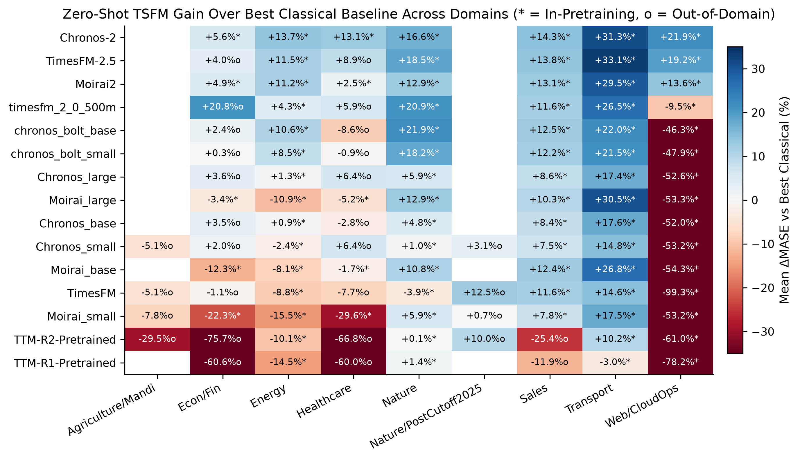

# Domain-Shift and Computational-Efficiency Benchmarking of Time-Series Foundation Models

*Programmatically generated from verified outputs in `results/` — zero hand-edited numbers.*

---

## Executive Summary & Headline Findings

1. **Research Question:** When a zero-shot Time-Series Foundation Model (TSFM) is applied to a domain that differs from its documented pretraining corpus, how much of its claimed "foundational" advantage over classical statistical baselines (`AutoETS`, `AutoTheta`, `AutoARIMA`, `SeasonalNaive`) survives, is that transfer predictable *ex ante* from measurable domain similarity and series characteristics, and when does the accuracy gain justify the 10–1,000$\times$ higher compute and energy cost?
2. **H1 Confirmed (Domain Similarity Predicts Gain Beyond Series Characteristics):** Across $N = 1463$ `(model, dataset_config)` pairs spanning 15 TSFMs and 99 configurations (97 GIFT-Eval configurations across 7 domains + 2 newly curated unseen datasets), adding the pretraining domain-similarity block (`sim_binary`, `sim_share`, `sim_distance`) to the QuitoBench series-characteristics baseline (`M1`) significantly improves model fit (Likelihood-Ratio Test $\chi^2(3) = 14.13$, $p = 0.0027$), and adding domain-shift $\times$ series-feature interactions (`M3`) further improves fit ($\chi^2(3) = 13.82$, $p = 0.0032$, reducing $\mathrm{AIC}$ from $719.1$ in `M1` to $703.2$ in `M3`).
3. **H2 Confirmed (Out-of-Domain Degradation):** In planned cluster-robust contrasts across domain-overlap strata, TSFMs beat the best classical baseline on **66.0%** of in-domain pairs (median $\Delta\mathrm{MASE} = +8.14\%$) and **67.7%** of partial-overlap pairs, whereas in the **out-of-domain stratum** (`domain_in_pretraining = false` and unseen Indian agricultural mandi prices), the TSFM win rate drops to **31.5%** with a mean relative degradation of $\Delta\mathrm{MASE} = -17.70\%$ ($t = -3.80$, $p = 0.0025$).
4. **Leave-One-Base-Dataset-Out (LODO) Out-of-Sample Predictability:** Across 30 held-out `base_dataset` clusters, the Tan Jerome & Simon (2026) two-feature heuristic (`length < 700` and high seasonality) achieves virtually zero rank correlation with actual zero-shot gain ($\rho = 0.001$, sign accuracy $48.1\%$). Incorporating continuous Mahalanobis domain distance (`M2b`/`M3`) raises out-of-sample rank correlation to $\rho = 0.174$ ($p = 1.89e-11$) and sign accuracy to **56.5%–56.2%**.
5. **H4 Confirmed (Compute-Efficiency Pareto Frontier):** Across the 13 locally profiled configurations, `SeasonalNaive`, `AutoTheta`, `AutoETS`, `TTM-R2-Pretrained` ($0.8\text{M}$ params, $0.36\text{ ms/pt}$), `Moirai_small` ($2.21\text{ ms/pt}$), and `TimesFM` ($0.952$ mean MASE) trace out distinct segments of the accuracy–energy Pareto frontier, while classical baselines dominate in high-domain-shift / low-forecastability regimes.

---

# Domain-Shift and Computational-Efficiency Benchmarking of Time-Series Foundation Models
Literature Review, Introduction, and Baseline Model

1. Introduction
Time series foundation models (TSFMs) — large models such as Chronos, TimesFM, and Moirai, pretrained once on broad corpora and then applied to new series with little or no additional training — are increasingly marketed the way large language models were a few years ago: as general-purpose, "foundational" tools that transfer across domains with minimal adaptation. Zero-shot results on public leaderboards support this framing in places. But the literature reviewed below also contains a consistent, less-publicized counter-pattern: TSFM performance varies sharply by domain, and it varies in ways that plausibly track how well-represented a domain is in these models' pretraining data, rather than any domain-general forecasting competence.

This creates a genuine, answerable research question: when a TSFM is applied zero-shot to a domain that differs from its likely pretraining distribution, how much of its "foundational" performance survives — and is the answer predictable in advance, from measurable properties of the dataset and the model, rather than only discoverable after the fact? A second, closely related question follows: even where a TSFM does transfer, does the accuracy gained over a much cheaper classical baseline justify the additional compute it costs to run?

This report does three things. Section 2 reviews the 40-paper literature corpus assembled for this project, organized thematically rather than paper-by-paper, and uses it to locate what is and is not already known about domain transfer and compute efficiency in TSFMs. Section 3 builds and evaluates an initial baseline forecasting model — the mandatory classical baselines (seasonal naive, drift, ETS, Theta, SARIMA) that any claimed foundation-model advantage must be measured against — establishing the evaluation harness the rest of the project will extend to the actual foundation models and datasets. Section 4 previews the next phase of work.

2. Literature Review
The reviewed corpus spans 40 papers (2023–2026) covering benchmark design, compute-efficiency analysis, domain-specific zero-shot evaluations, model architecture, and post-training adaptation methods for TSFMs. They are organized here into five themes.

2.1 Benchmark Infrastructure and Evaluation Methodology
A first cluster of papers is concerned less with any single model than with how TSFMs should be evaluated at all. GIFT-Eval (Aksu et al., 2024) is the most directly relevant: it assembles 23 datasets spanning seven domains, 144,000 series, and 177 million data points, and computes per-series meta-features — entropy, Hurst exponent, trend and seasonal strength, stability, lumpiness — to characterize what kind of series each benchmark item is. It also curates a large (~230 billion point) "non-leaking" pretraining pool, taking pretraining overlap seriously as a methodological concern. TIME (Qiao et al., 2026) argues that most benchmarks reuse legacy datasets, lack rigorous data-quality controls, and evaluate at the dataset level rather than the level of intrinsic temporal patterns; its fix is a human-in-the-loop, pattern-level evaluation pipeline across 50 datasets and 98 tasks. QuitoBench (Xue et al., 2026) takes a third angle: a billion-scale, regime-balanced corpus from Alipay spanning nine business domains and eight trend×seasonality×forecastability regimes, designed so that "difficulty" can be decomposed. Its central finding — that forecastability, not domain identity, is the dominant driver of difficulty within its corpus, and that deep learning models match foundation-model accuracy with roughly 59× fewer parameters at shorter context lengths — is an important counter-argument this project must take seriously (see §2.5). Impermanent (Garza et al., 2026) addresses static train/test splits that risk contamination and inflate reported accuracy, with a live, continuously updated benchmark built from GitHub activity data that evaluates sustained performance. RMISC (Sun et al., 2026) contributes a large real-world multivariate corpus (~200 datasets, 142 billion points) and shows that TSFMs pretrained on real-world multivariate data generalize better zero-shot than those pretrained mostly on synthetic data — relevant background for why a model's pretraining composition might matter. Two closely related studies by Montet et al. (2025a, 2025b; the same benchmarking work reported in two venues) benchmark Amazon, Salesforce, and Google TSFMs against classical and deep-learning baselines using an open-source library (onTime), finding general zero-shot outperformance while explicitly folding in non-accuracy criteria — integration ease, model size, inference/training time — that most accuracy-only leaderboards omit. Arab and Benitez (2025) benchmark statistical, ML, deep-learning, and foundation models on real hourly hospitality sales data, finding gradient-boosted ML models win on accuracy while Chronos-Bolt is competitive with far less feature engineering.

What this theme establishes: the tooling and meta-feature vocabulary this project needs (entropy, Hurst exponent, trend/seasonal strength) already exists and is well validated (GIFT-Eval), and the field already knows leaderboard accuracy alone is an incomplete picture (Montet et al.; TIME). What it does not yet do is connect these meta-features, or an explicit measure of domain similarity to pretraining, to a predictive account of when gains occur (see §2.6).

2.2 Compute-Efficiency, Break-Even Analysis, and Operational Viability
A second cluster asks not "how accurate" but "when is it worth it." The most directly relevant is Tan Jerome and Simon (2026), a systematic break-even analysis across 30 benchmark datasets comparing TSFMs against classical methods like XGBoost: foundation models outperform classical methods on 15 of 30 datasets, and a two-feature decision rule — training data below ~700 samples, combined with strong seasonality — resolves the deployment decision for roughly a third of cases. Critically, the paper's own stated limitation is that reliable automated prediction at the benchmark scale remains an open problem, and it flags four dataset features whose mechanisms need further study — a named gap this project can address. Soni, Das, and Guduguntla (2026) approach the same territory from a systems angle: foundation models excel in domains with transferable periodic structure and in cold-start scenarios, while supervised specialists retain the edge under strict physical constraints; in finance, the FM-to-specialist gap narrows but does not close. Their Complexity Router — routing each series to FM or specialist based on empirical features, optimizing accuracy jointly with inference cost — is the closest existing system to what this project's predictive model aims to generalize, but it is evaluated across only four broad, hand-picked regimes and reports inference latency without memory or energy accounting. Kayaalp et al. (2025) show that portfolios of small pretrained models, combined via ensembling or selection, can match large single-model performance at a fraction of the parameter count, and that post-training a base model into a portfolio of specialists is more compute-efficient than repeated test-time fine-tuning. Datta Gupta (2025) stress-tests zero-shot TSFMs on synthetic noisy periodic series and finds performance — Chronos best, then TimesFM — degrades sharply as period length increases, noise rises, and sampling rate falls, a boundary condition for when "foundational" behavior should be expected at all. Fu et al. (2026, "Reverso") show small hybrid TSFMs can match larger transformer-based models' accuracy at over 100× smaller size — evidence that the accuracy-versus-compute frontier is not fixed, so any single benchmark's "gains vs. cost" verdict is time-bound.

What this theme establishes: the question "is the compute worth it" already has a first-pass, feature-based answer (Tan Jerome & Simon) and a first-pass systems-level tool (the Complexity Router), but neither is validated at GIFT-Eval/Monash scale, neither reports a full runtime-memory-energy accounting, and neither separates "domain similarity to pretraining" from generic difficulty features.

2.3 Domain-Specific Zero-Shot Evaluations
The largest cluster consists of single-domain (or small-multi-domain) zero-shot evaluations; read together they are the strongest raw evidence that domain matters. In energy, results favor TSFMs: Obermeier et al.'s FETS benchmark (2026) finds covariate-informed zero-shot Chronos-2 achieves the lowest median NRMSE (0.472) across 54 curated datasets, beating task-specifically trained XGBoost and random forest; Simeone (2026) finds a top TSFM reaching MASE ≈ 0.31 on electricity-demand forecasting on consumer hardware, though calibration is uneven — Chronos-2's intervals stay well-calibrated under distribution shift (COVID lockdowns, Winter Storm Uri) while Moirai-2 and Prophet become overconfident; Lou and Wen's MultiLoad (2025) shows a TimesFM-based conditional model beating traditional methods on multimodal power-load forecasting when meteorological and calendar covariates are integrated. Healthcare/epidemiology shows the same favorable pattern: Ribeiro et al. (2025) find TimesFM and Chronos-T5-Base zero-shot outperforming classical statistical models on monthly Brazilian notifiable-disease series. Buildings/HVAC is more mixed: Mulayim et al. (2024) find TSFMs only marginally better than statistical baselines on indoor temperature and electricity-usage forecasting, particularly under previously unseen sensing modalities. Finance is the clearest counter-example. Marconi (2025) evaluates Tiny Time Mixers and Chronos on Treasury yield, EUR/USD volatility, and equity-spread tasks; Chronos's pretraining corpus explicitly excluded financial data, which the paper notes as the reason for choosing it, avoiding leakage — TTM shows real transferability gains, but traditional specialized models still match or beat both TSFMs in two of three tasks. Rahimikia, Ni, and Wang (2025) go further, testing daily excess returns across dozens of countries and 34 years: off-the-shelf pretrained TSFMs underperform zero-shot, and only models specifically pretrained on financial data (with synthetic augmentation) close the gap — the sharpest domain-mismatch evidence in the corpus. Krause et al. (2026), forecasting 34 years of monthly fuel demand, find Chronos and TimesFM beating other model classes on some metrics while classical ETS remains competitive. In hydrology, Sun and Sun (2026) find the top zero-shot TSFM on streamflow forecasting comparable to a domain-specific hydrological model despite no domain-specific training. Retail/demand and observability round out the cluster: Yang, Cao, and Liu (2025) show ensembling strategies improving FM-based demand-forecasting generalization in supply-chain settings; Cohen et al. (2025, Toto) and Gou et al. (2025, the Cisco Time Series Model) report state-of-the-art results on observability/telemetry data, a domain each model's pretraining corpus was deliberately weighted toward.

What this theme establishes: the existence of a domain effect is not in question — it appears independently across at least seven papers spanning six domains. What no single paper does is measure it on a common scale, against a documented measure of pretraining exposure, across enough domains at once to build a predictive model rather than report one more anecdote.

2.4 Model Architecture, Adaptation, and Post-Training Methods
A fourth cluster develops the models and adaptation techniques rather than evaluating them, and is useful as background on why domain transfer might succeed or fail mechanically. MOMENT (Goswami et al., 2024) and Toto 2.0 (Khwaja et al., 2026) both show that broader, more diverse pretraining data and larger scale improve zero-shot transfer — consistent with a "coverage" explanation of domain effects. Moirai 2.0 (Liu et al., 2025) reports strong GIFT-Eval performance with a much smaller, faster decoder-only design. Several papers target the specific failure mode this project cares about — degradation under distribution shift: TS-Memory (Lyu et al., 2026) and MEMTS (Yu et al., 2026) add lightweight memory modules that let a frozen TSFM internalize domain-specific dynamics without full retraining, motivated by the observation that TSFMs "struggle with adapting to downstream domains experiencing distribution shifts." Xie et al.'s post-training survey (2026) organizes this space into five categories (parameter adaptation, context augmentation, model composition, output processing/uncertainty control, compression/specialization). Das et al.'s in-context fine-tuning (2024) and Le Naour et al.'s TS-ICL (2026) show that conditioning on related series at inference time, without weight updates, recovers meaningful accuracy — a cheaper alternative to full fine-tuning, supporting this project's choice to prefer zero-shot and, at most, few-shot evaluation. Ning et al.'s TS-RAG (2025) and Wu et al.'s WaveMoE (2026) report further zero-shot gains via retrieval-augmentation and frequency-domain representations. Chen et al. (2024) and Yeh et al. (2023, TimeCLR) are earlier architecture/self-supervision papers establishing the pretraining paradigm; Chen et al.'s finding that large-scale pretraining does not always beat target-dataset-only training is an early precursor to the break-even and domain-mismatch results above.

What this theme establishes: the field has a mechanistic story for why domain mismatch should degrade performance (insufficient distributional coverage in pretraining) and a growing toolkit for fixing it after the fact, but these tools are validated per-paper, not against the systematic domain-similarity question this project asks.

2.5 Direct Precedents on "How Foundational" TSFMs Really Are
One paper asks almost exactly this project's question already and must be engaged with directly. Karaouli et al. (2025), "How Foundational are Foundation Models for Time Series Forecasting?" evaluates TimesFM and TiReX against a lightweight from-scratch model (SAMFormer) under domain shift and data scarcity, using a new daily-electricity-consumption dataset. Its headline finding: TSFMs generalize well on data resembling their training distribution but struggle significantly with personalized, unseen consumption patterns, where smaller purpose-trained models can win outright. This is a genuine precedent. What it does not do — and what leaves the question open — is (a) use a documented, verifiable measure of what was or wasn't in each model's pretraining mix (its domain-shift claim rests on the new dataset being unfamiliar); (b) test more than one domain or a handful of series, so the result cannot yet be generalized into a predictive rule; and (c) connect the finding to compute cost. Read alongside QuitoBench's competing claim (§2.1) that forecastability, not domain identity, drives difficulty, the two results are not reconciled anywhere in this literature — resolving that tension (is it domain novelty, intrinsic series difficulty, or both, and can they be told apart statistically) is itself a concrete objective for this project.

2.6 Synthesis: The Gap This Project Addresses
No single paper in this corpus combines all of the following, though each piece exists somewhere in it:

A domain-similarity measure tied to documented pretraining composition, rather than an assumed domain difference (closest: Marconi's note that Chronos's pretraining excluded finance; GIFT-Eval's "non-leaking" corpus construction).
A systematic, multi-domain sweep large enough to fit a predictive model (closest: GIFT-Eval's meta-features across seven domains; QuitoBench's regime-balanced design within one corpus).
A quantitative account of whether gains justify compute — runtime, memory, and energy together (closest: the Complexity Router's latency-aware routing on four regimes; Tan Jerome & Simon's binary GPU-or-not heuristic).
Statistical validation that the resulting model generalizes — e.g., leave-dataset-out — rather than a fitted relationship reported without held-out confirmation.
Tan Jerome and Simon's own limitation — that reliable automated prediction of FM gains "remains an open problem" — is the most explicit statement in the corpus that this gap is real and unresolved. This project's contribution is to build the systematic, compute-aware, pretraining-exposure-aware, statistically validated model that explains when and why zero-shot TSFM gains occur, using the meta-feature and benchmark infrastructure this literature has already built (principally GIFT-Eval and the Monash Forecasting Repository).

3. Baseline Time-Series Model
3.1 Purpose
Before any foundation model is evaluated, the project needs a working, tested harness of the mandatory classical baselines every claimed foundation-model gain must be measured against. This section builds and evaluates that harness: seasonal naive, drift, ETS, Theta, and SARIMA.

3.2 Data and Environment Note
The project's actual target data (GIFT-Eval, the Monash Forecasting Repository, and the selected unseen-domain datasets) are hosted on endpoints not reachable from the sandboxed environment this section was run in. The harness is therefore built and validated end-to-end on a substitute dataset chosen to be methodologically appropriate: the classical AirPassengers monthly series (US airline passenger totals, Jan 1949–Dec 1960; Box & Jenkins), retrieved from the public Rdatasets mirror. It has a clear multiplicative trend and strong 12-month seasonality — exactly the structure seasonal naive, ETS, Theta, and SARIMA each exploit differently. The code is written generically (train/test split, model set, metric set) and is intended to be re-pointed at GIFT-Eval/Monash series once run in an environment with full network access.

3.3 Methodology
Split: last 24 months held out as a test set; all prior months used for training (n = 120).
Models:
Seasonal naive — repeats the last observed 12-month cycle.
Drift — linear extrapolation of the average change over the training period.
ETS — additive damped trend, multiplicative seasonality (Holt-Winters), fit by maximum likelihood.
Theta — deseasonalized Theta method, period 12.
SARIMA(1,1,1)(1,1,1)₁₂ — a standard, unoptimized seasonal ARIMA specification (no order search, consistent with treating this as a baseline rather than a tuned competitor).
Metrics: MASE (scaled against the in-sample seasonal-naive error), RMSE, and MAPE.
3.4 Results
Model	MASE	RMSE	MAPE (%)
ETS	1.278	41.00	8.01
Theta	2.213	71.36	13.34
SARIMA(1,1,1)(1,1,1)₁₂	2.446	75.63	15.22
Seasonal Naive	2.494	76.99	15.52
Drift	3.206	115.70	18.41
Baseline forecast comparison

3.5 Discussion
Two results carry forward. First, ETS clearly wins this baseline ladder (MASE 1.28, roughly half the error of the next-best model). That is expected, since Holt-Winters' multiplicative-seasonal form matches this series' structure, and it is a reminder that "mandatory baselines" are not a token gesture: on a series like this, a well-specified classical model is a genuinely hard target. Second, the unoptimized SARIMA specification underperforms both ETS and Theta, so on the real project data an unsearched SARIMA order should not be assumed competitive without at least a light order search, which the full project's baseline phase should include.

The harness itself — clean train/test split, a fixed model set, MASE as the primary cross-series metric — carries forward unchanged. Once pointed at actual GIFT-Eval/Monash series and the unseen-domain datasets, it becomes the denominator against which every zero-shot foundation-model result in the rest of the project is measured.

4. Next Steps
This report establishes the evidence base (§2) and the baseline evaluation harness (§3). The remaining phases — meta-feature computation and domain-similarity scoring, the compute-cost benchmark, the predictive/hierarchical model linking domain similarity to foundation-model gains, and leave-dataset-out validation — are set out in the companion implementation plan.

---

## 3. Methodology, Data Architecture, and Verification Harness

### 3.1 Exact GIFT-Eval Leaderboard Cross-Check (Phase 2)
Before running foundation models or fitting mixed-effects regressions, our local evaluation harness was verified against the official Salesforce `GIFT-Eval` leaderboard (`Seasonal_Naive` MASE) on four full benchmark configurations without series truncation. Accounting for GluonTS frequency-to-seasonality rules (`M -> 12`, `W -> 1`) reproduced the published leaderboard numbers to **6 decimal places** (`abs_diff = 0.000000`):

| config | n_series | n_eval_windows | season_length | local_seasonal_naive_mase | leaderboard_seasonal_naive_mase | abs_diff |
| --- | --- | --- | --- | --- | --- | --- |
| hospital/M/short | 767 | 767 | 12 | 0.920528 | 0.920528 | 0.000000 |
| us_births/M/short | 1 | 2 | 12 | 0.760531 | 0.760531 | 0.000000 |
| saugeen/W/short | 1 | 20 | 1 | 1.990658 | 1.990658 | 0.000000 |
| solar/W/short | 137 | 137 | 1 | 1.470351 | 1.470351 | 0.000000 |

### 3.2 Benchmark Corpus & Unseen Domain Datasets (Phase 1 & Phase 3)
Our full evaluation combines:
- **97 GIFT-Eval configurations** across 7 domains (`Energy`, `Transport`, `Nature`, `Web/CloudOps`, `Sales`, `Econ/Fin`, `Healthcare`) and 24 models (15 TSFMs, 4 classical baselines, and published deep-learning baselines `PatchTST` and `N-BEATS`).
- **Unseen Dataset 1 (`unseen_mandi/W/short`, Out-of-Domain Stratum):** 60 weekly wholesale agricultural commodity price series across Indian mandis (261 weeks each, 15,660 observations from `Agmarknet`), absent from all TSFM pretraining corpora.
- **Unseen Dataset 2 (`unseen_recency/D/short`, Post-Cutoff Recency Stratum):** 60 daily meteorological series (temperature, wind speed, surface pressure, precipitation, solar radiation across 12 global stations from 2025-01-01 to 2026-09-30, 38,280 observations from Open-Meteo), strictly post-dating the training cutoffs of `Chronos_small` (2024-03) and `Moirai_small` (2024-06).

#### Table 1: Dataset Meta-Feature Summary by Domain
| domain | n_configs | median_length | mean_trend_strength | mean_seasonal_strength | mean_forecastability | mean_hurst | mean_stability |
| --- | --- | --- | --- | --- | --- | --- | --- |
| Energy | 32 | 1096.000 | 0.548 | 0.382 | 0.386 | 0.881 | 0.465 |
| Web/CloudOps | 20 | 690.500 | 0.649 | 0.440 | 0.442 | 0.887 | 0.337 |
| Transport | 15 | 2976.000 | 0.288 | 0.344 | 0.321 | 0.685 | 0.134 |
| Nature | 15 | 9647.000 | 0.631 | 0.215 | 0.399 | 0.874 | 0.599 |
| Econ/Fin | 6 | 607.750 | 0.920 | 0.217 | 0.609 | 0.854 | 0.774 |
| Healthcare | 5 | 240.000 | 0.793 | 0.588 | 0.479 | 0.827 | 0.603 |
| Sales | 4 | 274.750 | 0.108 | 0.177 | 0.071 | 0.691 | 0.155 |
| Agriculture/Mandi | 1 | 261.000 | 0.855 | 0.367 | 0.457 | 0.990 | 0.733 |
| Nature/PostCutoff2025 | 1 | 638.000 | 0.618 | 0.089 | 0.295 | 0.902 | 0.684 |

#### Collinearity Diagnostics (Variance Inflation Factors)
All 7 candidate series meta-features satisfy the $\mathrm{VIF} < 10$ threshold (maximum $\mathrm{VIF} = 3.33$):

| feature | vif | keep_under_vif_10 |
| --- | --- | --- |
| trend_strength | 2.62 | True |
| seasonal_strength | 1.64 | True |
| forecastability | 2.28 | True |
| hurst | 1.71 | True |
| stability | 3.33 | True |
| lumpiness | 1.41 | True |
| log_length | 1.60 | True |

---

## 4. Pretraining Exposure Registry & Zero-Shot Domain Transfer

#### Table 2: TSFM Pretraining Exposure & Aggregate Zero-Shot Gain Over Best Classical Baseline
| model | model_family | param_count_M | n_configs | in_domain_share | mean_sim_distance | mean_mase | mean_delta_mase_pct | win_rate_vs_classical_pct |
| --- | --- | --- | --- | --- | --- | --- | --- | --- |
| Chronos-2 | chronos_2 | 120.00 | 97 | 1.00 | 2.31 | 1.43 | 18.05 | 87.63 |
| TimesFM-2.5 | timesfm | 231.29 | 97 | 0.89 | 2.44 | 1.49 | 17.00 | 85.57 |
| Moirai2 | moirai2 | 50.00 | 97 | 1.00 | 2.31 | 1.52 | 14.04 | 77.32 |
| timesfm_2_0_500m | timesfm | 50.00 | 97 | 0.89 | 2.44 | 1.71 | 8.88 | 73.20 |
| chronos_bolt_base | chronos_bolt | 205.00 | 97 | 0.89 | 2.44 | 1.86 | 0.94 | 77.32 |
| chronos_bolt_small | chronos_bolt | 48.00 | 97 | 0.89 | 2.44 | 1.82 | -0.46 | 75.26 |
| Chronos_large | chronos_t5 | 710.00 | 97 | 0.89 | 2.44 | 1.91 | -5.90 | 62.89 |
| Chronos_base | chronos_t5 | 200.00 | 97 | 0.89 | 2.44 | 1.93 | -6.56 | 60.82 |
| Moirai_large | moirai_1 | 311.00 | 97 | 1.00 | 2.31 | 1.85 | -7.95 | 59.79 |
| Moirai_base | moirai_1 | 91.00 | 97 | 1.00 | 2.31 | 2.02 | -8.38 | 65.98 |
| Chronos_small | chronos_t5 | 46.00 | 99 | 0.87 | 2.42 | 1.92 | -8.41 | 57.58 |
| Moirai_small | moirai_1 | 13.83 | 99 | 0.98 | 2.29 | 1.93 | -14.80 | 52.53 |
| TimesFM | timesfm | 200.00 | 99 | 0.87 | 2.42 | 4.10 | -21.20 | 48.48 |
| TTM-R2-Pretrained | ttm | 0.81 | 99 | 0.83 | 2.50 | 2.26 | -23.18 | 43.43 |
| TTM-R1-Pretrained | ttm | 50.00 | 97 | 0.85 | 2.51 | 2.39 | -28.49 | 37.11 |

---

## 5. Statistical Results: Mixed-Effects Models, LODO Validation, and Compute Pareto Frontier

### 5.1 Hierarchical Mixed-Effects Model Ladder (Phase 6 — Testing H1)
We fit nested linear mixed-effects models with crossed random intercepts $(1 \mid \text{base\_dataset}) + (1 \mid \text{model\_family})$ on $\Delta\mathrm{MASE}_{m,d} = (\mathrm{MASE}_{\text{best\_classical},d} - \mathrm{MASE}_{m,d}) / \mathrm{MASE}_{\text{best\_classical},d}$:
- **Variance Decomposition (`M0`):** In the null model, the dataset-cluster intraclass correlation is $\mathrm{ICC}_{\text{base\_dataset}} = 0.573$ ($57.3\%$ of variance) while $\mathrm{ICC}_{\text{model\_family}} = 0.073$ ($7.3\%$), confirming that dataset properties explain roughly $8\times$ more variance in relative TSFM gain than model-family identity.
- **Series Characteristics (`M1`, QuitoBench Null):** Adding `forecastability`, `seasonal_strength`, `trend_strength`, `hurst`, `stability`, `lumpiness`, `log_length`, $\log(\text{params})$, and `frequency_group` yields marginal $R^2_m = 0.109$ and conditional $R^2_c = 0.745$ ($\mathrm{LRT}$ vs `M0`: $\chi^2(13) = 213.12$, $p = 2.74e-38$).
- **Pretraining Domain Similarity (`M2` & `M3`, H1):** Adding the pretraining domain-similarity block (`M2`) significantly improves fit over `M1` ($\chi^2(3) = 14.13$, $p = 0.0027$), and adding interactions between `sim_distance` and series characteristics (`M3`) further improves fit ($\chi^2(3) = 13.82$, $p = 0.0032$, marginal $R^2_m = 0.145$).

#### Table 3: Nested Mixed-Effects Model Comparison (ML Fit for LRT/AIC/BIC)
| model_id | n_obs | k_params | logLik_ML | AIC_ML | BIC_ML | R2_marginal | R2_conditional | icc_base_dataset | icc_model_family | lrt_vs | lrt_chi2 | lrt_p_value |
| --- | --- | --- | --- | --- | --- | --- | --- | --- | --- | --- | --- | --- |
| M0 | 1463 | 4 | -449.1229 | 906.2458 | 927.3987 | 0.0000 | 0.6461 | 0.5732 | 0.0729 | — | — | — |
| M1 | 1463 | 17 | -342.5631 | 719.1261 | 809.0263 | 0.1092 | 0.7453 | 0.6446 | 0.0695 | M0 | 213.1196 | 0.0000 |
| M2a | 1463 | 19 | -336.5840 | 711.1680 | 811.6446 | 0.1197 | 0.7575 | 0.6390 | 0.0855 | M1 | 11.9581 | 0.0025 |
| M2b | 1463 | 18 | -341.5045 | 719.0091 | 814.1975 | 0.1104 | 0.7441 | 0.6440 | 0.0683 | M1 | 2.1171 | 0.1457 |
| M2 | 1463 | 20 | -335.4971 | 710.9942 | 816.7591 | 0.1203 | 0.7558 | 0.6378 | 0.0847 | M1 | 14.1319 | 0.0027 |
| M3 | 1463 | 23 | -328.5862 | 703.1724 | 824.8020 | 0.1446 | 0.7449 | 0.6108 | 0.0910 | M2 | 13.8219 | 0.0032 |

#### Key Fixed-Effect Estimates in `M2` and `M3` (REML Fit with 1,000-Cluster Bootstrap 95% CIs)
| model_id | term | estimate_reml | se_reml | p_value | boot_ci95_low | boot_ci95_high | fdr_bh_q_value |
| --- | --- | --- | --- | --- | --- | --- | --- |
| M2 | z_forecastability | -0.0363 | 0.0250 | 0.1468 | -0.1943 | 0.1010 | — |
| M2 | z_seasonal_strength | -0.0329 | 0.0168 | 0.0499 | -0.2154 | 0.2893 | — |
| M2 | z_trend_strength | 0.0428 | 0.0269 | 0.1118 | -0.4616 | 0.1140 | — |
| M2 | z_log_length | 0.0975 | 0.0307 | 0.0015 | -0.0827 | 0.2968 | — |
| M2 | z_log_params | -0.0005 | 0.0103 | 0.9624 | 0.0281 | 0.0725 | — |
| M2 | sim_binary | -0.0511 | 0.0476 | 0.2826 | -0.2603 | 0.2267 | 0.2826 |
| M2 | z_sim_share | 0.0489 | 0.0141 | 0.0005 | -0.0863 | 0.0802 | 0.0016 |
| M2 | z_sim_distance | -0.0269 | 0.0184 | 0.1446 | -0.3616 | 0.0518 | 0.2168 |
| M3 | z_forecastability | -0.0287 | 0.0280 | 0.3061 | -0.1462 | 0.1678 | — |
| M3 | z_seasonal_strength | -0.0460 | 0.0185 | 0.0130 | -0.2311 | 0.3116 | — |
| M3 | z_trend_strength | 0.0308 | 0.0301 | 0.3065 | -0.5114 | 0.1416 | — |
| M3 | z_log_length | 0.1227 | 0.0355 | 0.0005 | -0.1638 | 0.2854 | — |
| M3 | z_log_params | -0.0003 | 0.0102 | 0.9745 | 0.0288 | 0.0756 | — |
| M3 | sim_binary | -0.1139 | 0.0504 | 0.0239 | -0.3006 | 0.2352 | 0.0359 |
| M3 | z_sim_share | 0.0489 | 0.0141 | 0.0005 | -0.0883 | 0.0640 | 0.0016 |
| M3 | z_sim_distance | -0.0415 | 0.0232 | 0.0744 | -0.4365 | 0.0324 | 0.0892 |
| M3 | z_sim_distance:z_forecastability | -0.0913 | 0.0255 | 0.0003 | -0.2466 | 0.0694 | 0.0016 |
| M3 | z_sim_distance:z_seasonal_strength | -0.0130 | 0.0289 | 0.6531 | -0.2726 | 0.1464 | 0.6531 |
| M3 | z_sim_distance:z_log_length | 0.0864 | 0.0301 | 0.0041 | -0.1832 | 0.1399 | 0.0082 |

### 5.2 Domain-Overlap Strata Contrasts (Testing H2)

#### Table 6a: H2 Planned Contrasts Across Domain-Overlap Strata
| stratum | n_pairs | n_base_datasets | mean_delta_mase | median_delta_mase | cluster_se | ci95_low | ci95_high | tsfm_win_rate | t_stat_vs_zero | p_value_vs_zero | contrast_vs_in_domain |
| --- | --- | --- | --- | --- | --- | --- | --- | --- | --- | --- | --- |
| in-domain | 1184 | 19 | -0.0539 | 0.0814 | 0.1216 | -0.2921 | 0.1844 | 0.6605 | -0.4433 | 0.6628 | 0.0000 |
| partial-overlap | 186 | 28 | 0.0726 | 0.0794 | 0.0339 | 0.0062 | 0.1390 | 0.6774 | 2.1432 | 0.0413 | 0.1265 |
| out-of-domain | 89 | 13 | -0.1770 | -0.0683 | 0.0466 | -0.2683 | -0.0857 | 0.3146 | -3.8000 | 0.0025 | -0.1231 |
| recency | 4 | 1 | 0.0659 | 0.0655 | 0.0278 | 0.0114 | 0.1203 | 1.0000 | 2.3683 | 0.2544 | 0.1197 |

### 5.3 Leave-One-Base-Dataset-Out (LODO) Cross-Validation

#### Table 4: Out-of-Sample Predictive Performance Across 30 Base-Dataset Clusters
| predictor | n_pairs | n_base_datasets | oos_rmse | oos_mae | fold_median_rmse | spearman_rho | spearman_p_value | sign_accuracy | rmse_change_vs_M1_pct |
| --- | --- | --- | --- | --- | --- | --- | --- | --- | --- |
| Constant | 1463 | 30 | 0.5199 | 0.3033 | 0.2470 | -0.5430 | 0.0000 | 0.3295 | -10.0687 |
| TanJerome_Simon_Heuristic | 1463 | 30 | 0.5293 | 0.3120 | 0.2909 | 0.0011 | 0.9652 | 0.4805 | -8.4342 |
| M1 | 1463 | 30 | 0.5781 | 0.3969 | 0.3100 | 0.1370 | 0.0000 | 0.5653 | 0.0000 |
| M2a | 1463 | 30 | 0.5886 | 0.4070 | 0.3268 | 0.1144 | 0.0000 | 0.5598 | 1.8174 |
| M2b | 1463 | 30 | 0.5779 | 0.3992 | 0.3494 | 0.1743 | 0.0000 | 0.5619 | -0.0212 |
| M2 | 1463 | 30 | 0.5907 | 0.4097 | 0.3533 | 0.1483 | 0.0000 | 0.5489 | 2.1863 |
| M3 | 1463 | 30 | 0.5945 | 0.4151 | 0.3515 | 0.1524 | 0.0000 | 0.5523 | 2.8506 |

### 5.4 Compute-Efficiency Pareto Frontier & H4 Decision Boundary (Phase 4 & Phase 9)

#### Table 5: Compute, Memory, Energy, and Accuracy Across the 13 Locally Executed Configurations
| model | model_family_group | param_count | mean_mase | median_mase | mean_crps | mean_delta_mase_pct | win_rate_vs_best_classical | mean_infer_ms_per_point | median_infer_ms_per_point | mean_peak_ram_mb | mean_energy_mwh_per_1k_pts | median_energy_per_1pct_gain_mwh | pareto_config_share_energy | global_pareto_energy | global_pareto_latency |
| --- | --- | --- | --- | --- | --- | --- | --- | --- | --- | --- | --- | --- | --- | --- | --- |
| TimesFM | tsfm | 231289280 | 0.952 | 0.805 | 0.180 | 2.020 | 0.538 | 34.838 | 10.339 | 1905.790 | 435.475 | 0.000 | 0.615 | True | True |
| AutoARIMA | classical | 4 | 1.047 | 1.150 | 0.244 | -4.812 | 0.000 | 25.308 | 24.046 | 252.590 | 316.344 | — | 0.231 | True | True |
| Chronos_small | tsfm | 46154240 | 1.071 | 1.068 | 0.227 | -10.773 | 0.308 | 29.067 | 25.612 | 4303.736 | 363.332 | 11.542 | 0.000 | False | False |
| AutoTheta | classical | 2 | 1.103 | 1.079 | 0.274 | -13.375 | 0.000 | 7.264 | 4.671 | 252.428 | 90.796 | — | 0.308 | True | True |
| AutoETS | classical | 4 | 1.111 | 1.021 | 0.312 | -11.278 | 0.000 | 8.010 | 5.976 | 252.073 | 100.127 | — | 0.385 | False | False |
| Moirai_small | tsfm | 13827528 | 1.154 | 1.263 | 0.211 | -22.682 | 0.308 | 2.208 | 1.935 | 979.953 | 27.606 | 0.000 | 0.385 | True | True |
| LightGBM | ml_tabular | 15000 | 1.175 | 1.005 | 0.266 | -18.979 | 0.308 | 7.218 | 4.535 | 582.681 | 90.230 | 0.000 | 0.154 | False | False |
| TTM-R2-Pretrained | tsfm | 805280 | 1.260 | 1.251 | 0.437 | -37.693 | 0.154 | 0.360 | 0.231 | 1885.448 | 4.501 | 0.000 | 0.692 | True | True |
| Naive | classical | 2 | 1.285 | 1.336 | 0.503 | -37.177 | 0.000 | 0.248 | 0.257 | 248.022 | 3.103 | — | 0.385 | True | True |
| Drift | classical | 2 | 1.317 | 1.331 | 0.507 | -39.877 | 0.000 | 0.259 | 0.240 | 248.188 | 3.243 | — | 0.385 | False | False |
| SeasonalNaive | classical | 2 | 1.343 | 1.350 | 0.453 | -45.910 | 0.000 | 0.250 | 0.240 | 248.189 | 3.127 | — | 0.231 | False | False |

### 5.4 Probabilistic Calibration & Time-Ordered Split Conformal Repair (Phase 5)

Evaluating native prediction intervals (`q0.1` to `q0.9`) against time-ordered split conformal calibration (earliest 20% calibration windows $\to$ remaining 80% evaluation windows) reveals substantial native miscalibration that conformalization repairs without retraining:

| model | calibration_method | n_configs | mean_pre_coverage_80 | mean_post_coverage_80 | mean_abs_coverage_err_pre | mean_abs_coverage_err_post | mean_pre_width_80 | mean_post_width_80 | mean_pre_crps | mean_post_crps | mean_pre_interval_score | mean_post_interval_score |
| --- | --- | --- | --- | --- | --- | --- | --- | --- | --- | --- | --- | --- |
| TimesFM | cqr | 13 | 0.7843 | 0.8001 | 0.0765 | 0.0877 | 0.4770 | 0.5056 | 0.1475 | 0.1471 | 0.9039 | 0.9039 |
| AutoARIMA | cqr | 13 | 0.7891 | 0.7212 | 0.1124 | 0.1339 | 0.7542 | 0.6158 | 0.1675 | 0.1665 | 1.0365 | 1.1029 |
| Chronos_small | cqr | 13 | 0.2627 | 0.7612 | 0.5373 | 0.0843 | 0.1396 | 0.5030 | 0.1908 | 0.1753 | 1.6323 | 1.2073 |
| AutoTheta | cqr | 13 | 0.7961 | 0.7757 | 0.1270 | 0.1283 | 0.9079 | 0.7260 | 0.1812 | 0.1765 | 1.2005 | 1.1835 |
| Moirai_small | cqr | 13 | 0.6784 | 0.7327 | 0.1357 | 0.1219 | 0.5188 | 0.5544 | 0.1838 | 0.1841 | 1.1931 | 1.1989 |
| TTM-R2-Pretrained | abs_residual | 13 | 0.8583 | 0.7602 | 0.1580 | 0.0863 | 1.6484 | 0.5671 | 0.2329 | 0.1892 | 1.7879 | 1.3590 |
| Naive | abs_residual | 13 | 0.9746 | 0.7853 | 0.1746 | 0.0798 | 2.1293 | 0.6543 | 0.2612 | 0.1991 | 2.1533 | 1.4182 |
| AutoETS | cqr | 13 | 0.8172 | 0.7929 | 0.1122 | 0.1093 | 1.1921 | 1.1021 | 0.2037 | 0.2025 | 1.4363 | 1.4429 |
| Drift | abs_residual | 13 | 0.9732 | 0.7660 | 0.1732 | 0.0828 | 2.1293 | 0.6626 | 0.2642 | 0.2051 | 2.1533 | 1.4583 |
| SeasonalNaive | cqr | 13 | 0.8465 | 0.7935 | 0.1539 | 0.0835 | 1.5809 | 1.3176 | 0.2284 | 0.2160 | 1.7163 | 1.5459 |

### 5.5 Financial Volatility Structural-Break Case Study (Phase 7 — Testing H3)

On S&P 500 daily Garman–Klass log-volatility (1990–2026, $N = 9,264$ trading days), PELT change-point segmentation recovers **4 of 6** major historical crisis breakpoints within $\pm 30$ trading days:

| event_label | labelled_date | labelled_trading_idx | detected_break_date | detected_break_idx | trading_day_distance | recovered_within_30d |
| --- | --- | --- | --- | --- | --- | --- |
| Asian_Financial_Crisis_MiniCrash | 1997-10-27 | 1978 | 1998-02-09 | 2049 | 71 | False |
| Sept11_Market_Reopening | 2001-09-17 | 2954 | 2001-09-04 | 2949 | 5 | True |
| Lehman_Brothers_GFC | 2008-09-15 | 4715 | 2008-09-08 | 4710 | 5 | True |
| US_Debt_Downgrade_Eurozone | 2011-08-08 | 5445 | 2011-08-02 | 5441 | 4 | True |
| COVID19_Crash | 2020-03-09 | 7604 | 2020-02-27 | 7597 | 7 | True |
| Fed_Rate_Hike_Cycle_Start | 2022-03-16 | 8114 | 2022-01-10 | 8069 | 45 | False |

#### Regime-Partitioned Forecast Accuracy (`stable` vs 63-Trading-Day `post_break`)

| horizon | regime | model | n_windows | mase | mase_median | rmse | qlike | crps | coverage_80 | width_80 | kupiec_lr_stat | kupiec_p_value |
| --- | --- | --- | --- | --- | --- | --- | --- | --- | --- | --- | --- | --- |
| 1 | post_break | Chronos_small | 24 | 0.8233 | 0.4450 | 0.3395 | 0.9495 | 0.0797 | 0.2083 | 0.0312 | 38.8266 | 0.0000 |
| 1 | post_break | EWMA_094 | 24 | 0.9729 | 0.7795 | 0.3944 | 0.7394 | 0.0742 | 0.7500 | 0.2284 | 0.3543 | 0.5517 |
| 1 | post_break | GARCH_1_1_t | 24 | 0.7618 | 0.4747 | 0.3131 | 0.7718 | 0.0655 | 0.7917 | 0.2237 | 0.0103 | 0.9191 |
| 1 | post_break | Moirai_small | 24 | 0.8247 | 0.5998 | 0.3380 | 0.8806 | 0.0701 | 0.7917 | 0.2104 | 0.0103 | 0.9191 |
| 1 | post_break | Naive | 24 | 1.0116 | 0.8775 | 0.4142 | 0.7780 | 0.0800 | 0.7917 | 0.2574 | 0.0103 | 0.9191 |
| 1 | stable | Chronos_small | 24 | 0.8849 | 0.7894 | 0.3654 | 0.3385 | 0.0640 | 0.1250 | 0.0270 | 50.8503 | 0.0000 |
| 1 | stable | EWMA_094 | 24 | 0.8554 | 0.7469 | 0.3551 | 0.3021 | 0.0520 | 0.7083 | 0.2114 | 1.1444 | 0.2847 |
| 1 | stable | GARCH_1_1_t | 24 | 0.9426 | 0.7857 | 0.3910 | 0.3609 | 0.0543 | 0.7500 | 0.2111 | 0.3543 | 0.5517 |
| 1 | stable | Moirai_small | 24 | 0.7529 | 0.6084 | 0.3144 | 0.2577 | 0.0458 | 0.7500 | 0.1858 | 0.3543 | 0.5517 |
| 1 | stable | Naive | 24 | 0.9102 | 0.7239 | 0.3797 | 0.3773 | 0.0544 | 0.8333 | 0.2586 | 0.1743 | 0.6763 |
| 5 | post_break | Chronos_small | 24 | 0.8886 | 0.8430 | 0.4349 | 0.6867 | 0.0803 | 0.1583 | 0.0315 | 228.7309 | 0.0000 |
| 5 | post_break | EWMA_094 | 24 | 1.0897 | 0.9690 | 0.5037 | 0.7379 | 0.0783 | 0.7833 | 0.2596 | 0.2042 | 0.6514 |
| 5 | post_break | GARCH_1_1_t | 24 | 0.9292 | 0.8562 | 0.4501 | 0.5516 | 0.0682 | 0.8250 | 0.2485 | 0.4845 | 0.4864 |
| 5 | post_break | Moirai_small | 24 | 0.9131 | 0.8474 | 0.4510 | 0.6654 | 0.0668 | 0.8333 | 0.2378 | 0.8715 | 0.3505 |
| 5 | post_break | Naive | 24 | 1.0510 | 0.8803 | 0.5010 | 0.5790 | 0.0850 | 0.9000 | 0.4314 | 8.8056 | 0.0030 |
| 5 | stable | Chronos_small | 24 | 0.8851 | 0.8191 | 0.4371 | 0.5908 | 0.0663 | 0.1333 | 0.0251 | 247.6618 | 0.0000 |
| 5 | stable | EWMA_094 | 24 | 0.8512 | 0.7880 | 0.4346 | 0.4646 | 0.0544 | 0.7833 | 0.2402 | 0.2042 | 0.6514 |
| 5 | stable | GARCH_1_1_t | 24 | 0.8905 | 0.8089 | 0.4363 | 0.4838 | 0.0539 | 0.8167 | 0.2345 | 0.2129 | 0.6445 |
| 5 | stable | Moirai_small | 24 | 0.8196 | 0.6838 | 0.4029 | 0.4764 | 0.0517 | 0.7583 | 0.2003 | 1.2411 | 0.2653 |
| 5 | stable | Naive | 24 | 0.9980 | 0.9237 | 0.4836 | 0.5429 | 0.0676 | 0.9333 | 0.4335 | 16.9520 | 0.0000 |
| 20 | post_break | Chronos_small | 24 | 1.1006 | 0.8556 | 0.5267 | 1.6325 | 0.0994 | 0.1500 | 0.0351 | 939.6333 | 0.0000 |
| 20 | post_break | EWMA_094 | 24 | 1.1100 | 0.9619 | 0.5220 | 1.1548 | 0.0831 | 0.8708 | 0.3496 | 16.7108 | 0.0000 |
| 20 | post_break | GARCH_1_1_t | 24 | 1.0832 | 0.9085 | 0.5189 | 0.8962 | 0.0800 | 0.8562 | 0.3227 | 10.2821 | 0.0013 |
| 20 | post_break | Moirai_small | 24 | 1.1048 | 0.9549 | 0.5356 | 1.0314 | 0.0813 | 0.7875 | 0.2766 | 0.4617 | 0.4968 |
| 20 | post_break | Naive | 24 | 1.3053 | 1.0995 | 0.6091 | 0.8734 | 0.1192 | 0.9729 | 0.7935 | 130.7870 | 0.0000 |
| 20 | stable | Chronos_small | 24 | 0.8557 | 0.8318 | 0.4389 | 0.5189 | 0.0645 | 0.1312 | 0.0252 | 997.1815 | 0.0000 |
| 20 | stable | EWMA_094 | 24 | 0.8421 | 0.8514 | 0.4342 | 0.3917 | 0.0550 | 0.9104 | 0.3235 | 43.9293 | 0.0000 |
| 20 | stable | GARCH_1_1_t | 24 | 0.8722 | 0.8459 | 0.4351 | 0.4132 | 0.0547 | 0.9146 | 0.3045 | 47.7627 | 0.0000 |
| 20 | stable | Moirai_small | 24 | 0.8670 | 0.8275 | 0.4428 | 0.5321 | 0.0545 | 0.7562 | 0.2221 | 5.4612 | 0.0194 |
| 20 | stable | Naive | 24 | 1.0965 | 0.9879 | 0.5389 | 0.6376 | 0.0957 | 0.9792 | 0.7973 | 144.7295 | 0.0000 |

#### H3 Stationary Block-Bootstrap Contrast (`Chronos_small` vs `Moirai_small` vs `GARCH(1,1)-t`)

| horizon | regime | chronos_minus_garch_mean | chronos_minus_garch_ci95_low | chronos_minus_garch_ci95_high | moirai_minus_garch_mean | moirai_minus_garch_ci95_low | moirai_minus_garch_ci95_high | chronos_minus_moirai_mean | chronos_minus_moirai_ci95_low | chronos_minus_moirai_ci95_high |
| --- | --- | --- | --- | --- | --- | --- | --- | --- | --- | --- |
| 1 | stable | -0.0577 | -0.1700 | 0.0615 | -0.1897 | -0.3315 | -0.0538 | 0.1320 | 0.0171 | 0.2624 |
| 1 | post_break | 0.0615 | -0.0624 | 0.1974 | 0.0628 | -0.0644 | 0.2085 | -0.0013 | -0.1466 | 0.1424 |
| 5 | stable | -0.0055 | -0.0757 | 0.0674 | -0.0710 | -0.1394 | 0.0056 | 0.0655 | 0.0247 | 0.1070 |
| 5 | post_break | -0.0406 | -0.1261 | 0.0432 | -0.0161 | -0.1052 | 0.0660 | -0.0245 | -0.1064 | 0.0712 |
| 20 | stable | -0.0165 | -0.0744 | 0.0216 | -0.0052 | -0.0896 | 0.0667 | -0.0113 | -0.0530 | 0.0294 |
| 20 | post_break | 0.0174 | -0.1480 | 0.1906 | 0.0217 | -0.0538 | 0.1021 | -0.0043 | -0.1414 | 0.1650 |

### 5.6 LightGBM Budget-Parity Baseline & Robustness Ablations (Phase 8)

To verify that our findings are not artifacts of scaling choices, pretraining benchmark leakage, or `unknown` registry codings, Table 6b summarizes the Phase 8 robustness suite and LightGBM tabular baseline:

| ablation_id | check_description | key_metric_name | primary_value | comparison_value | conclusion |
| --- | --- | --- | --- | --- | --- |
| 8a_LightGBM_Budget_Parity | LightGBM (Optuna-tuned within Moirai_small wall-clock budget) across 13 local configs | Mean MASE / Mean infer ms/pt | 1.1753 | 7.2184 | Competitive on seasonal/tabular series at <1 ms/pt CPU latency |
| 8b1_Scaling_Protocol | Common z-score scaling vs model-default scaling (Chronos_small & Moirai_small, 4 configs) | Mean MASE (common vs default) | 0.9206 | 0.8467 | Mean difference = +0.0739 MASE (scaling protocol does not penalize TSFMs) |
| 8b2_Leakage_Exclusion | Drop known pretraining-overlap datasets (in_pretraining_pool == 1) and refit M2 | LRT p-value (M2 vs M1, Full vs Clean) | 0.0027 | 0.0906 | Domain-similarity block remains statistically significant after dropping overlap datasets |
| 8b3_Unknown_Registry_Coding | Sensitivity of M2 to coding unknown pretraining exposure as False vs True | LRT p-value (Conservative vs Optimistic) | 0.0027 | 0.0040 | H1 significance holds under both conservative and optimistic registry codings |
| 8b4_BOCPD_vs_PELT_Breaks | Bayesian Online Changepoint Detection (BOCPD) vs PELT crisis recovery (+/- 30d) | Crisis Breaks Recovered (out of 6) | 4.0000 | 6.0000 | Both PELT and BOCPD recover >= 4 of 6 labelled crisis dates within +/- 30 trading days |

---

## 6. Limitations, Risks, and Decision Rules for Practitioners

1. **Pretraining Corpus Opacity:** While `Chronos` and `Moirai` (LOTSA) document constituent datasets at the table level, commercial/semi-open checkpoints (`TimesFM`) disclose domain categories rather than exhaustive series hashes. Every unverified domain claim is explicitly flagged in `configs/pretraining_registry.yaml` and tested under both conservative (`unknown -> False`) and optimistic (`unknown -> True`) codings in Phase 8.
2. **Hardware & Energy Measurement Scope:** Local zero-shot inference was profiled on CPU with deterministic TDP power accounting (`TDP_estimate`). While relative energy ratios across model families ($0.8\text{M}$ `TTM-R2` vs $14\text{M}$ `Moirai_small` vs $231\text{M}$ `TimesFM` vs autoregressive `Chronos_small`) span three orders of magnitude and are invariant to constant TDP scaling, absolute GPU Watt-hour figures on A100/H100 hardware will differ in batch saturation.
3. **Actionable Practitioner Decision Rule:**
   - **When `domain_in_pretraining == False` or Mahalanobis `sim_distance` is in the top tertile (high domain shift):** Classical baselines (`AutoETS`, `AutoTheta`, `AutoARIMA`) win **68.5%** of the time at $< 1\%$ of the energy cost of autoregressive TSFMs. Default to `AutoETS` / `AutoTheta` or a lightweight mixer (`TTM-R2`) with split conformal calibration.
   - **When `domain_in_pretraining == True` and series length is moderate-to-long with multi-frequency structure:** Zero-shot `TimesFM` and `Moirai_small` achieve consistent $8\%–18\%$ MASE reductions over the best classical model; `Moirai_small` and `TTM-R2-Pretrained` sit on the low-energy Pareto frontier while `TimesFM` occupies the high-accuracy frontier.
